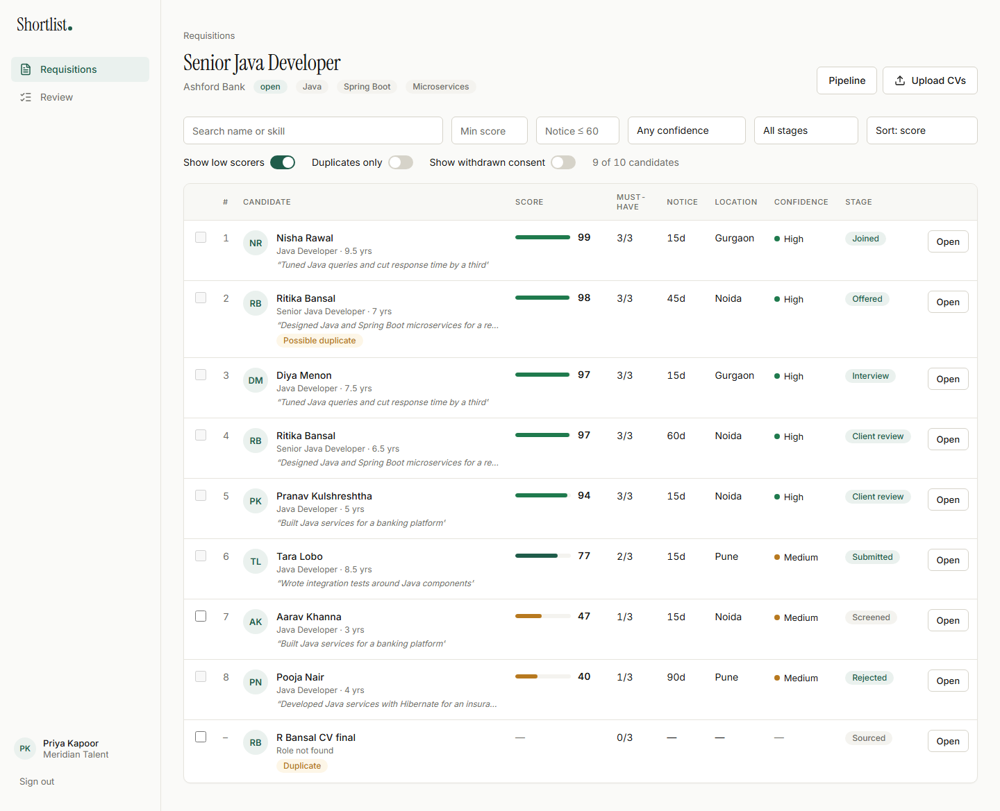

# Shortlist

**The right CVs, first.** A CV screening workspace and client shortlist portal for a staffing firm.

A recruiter pastes a job description and gets an editable scorecard. They upload a pile of CVs and see a ranked list where every score is backed by a line quoted from the CV. They open a CV before submitting it. The client reviews the shortlist on their phone with masked contacts, then shortlists, rejects with a reason, or proposes an interview slot. Every action is logged; candidates have a consent record and can be deleted.



| | |
|---|---|
| Demo | Not deployed yet. See [deployment.md](deployment.md) to run it locally. |
| Design doc | [docs/TDD.md](docs/TDD.md) (PDF: `docs/TDD.pdf`) |
| Honest status | [BUILD_LOG.md](BUILD_LOG.md) lists assumptions, cuts and known limits |

## What it does

- JD intake with AI-extracted must-haves, experience, notice and CTC, in an editable weighted scorecard
- Bulk upload of PDF and DOCX (up to 500), parsing, and duplicate detection
- Per-criterion score with a **verified verbatim quote**; unverifiable quotes are never shown as evidence
- Ranked list with filters, a candidate drawer, and a server-enforced "open the CV before submitting" gate
- Client portal (mobile-first): masked contacts, view-only CV, shortlist, reject with reason, propose slot
- Pipeline from Sourced to Joined with drag and drop, audited moves
- Consent record, withdrawal, deletion on request, access log, and an AI-vs-recruiter fairness sample

## Principles

AI ranks and explains; people decide. Nobody is rejected automatically, and low scorers stay searchable. Name, gender, age, photo and marital status are removed before scoring.

## Honest limits

- The Groq model path is written but **has not been run against the live API**. Demo scores come from a labelled rule-based extractor.
- Scanned CVs are flagged for review, not OCR'd.
- Not deployed; no GitHub remote yet.

## Quick start

```bash
npm install
cp .env.example .env     # set DATABASE_URL, DIRECT_URL, AUTH_SECRET, AI_MOCK=1
npx prisma migrate deploy && npx prisma db seed && npm run seed:demo
npm run dev
```

Sign in as `recruiter@meridian.example` or `hiring@ashfordbank.example` with `Demo1234!`.

## Stack

Next.js 16 (App Router), TypeScript, Tailwind 4, Prisma 6 and Postgres, Auth.js v5, Groq SDK, unpdf, mammoth, dnd-kit, Vitest, Playwright.

## Tests

`npm run test` (44 unit and integration), `npm run test:e2e` (3 Playwright flows), `node scripts/smoke.mjs` (49 HTTP checks). Details in the TDD, section 11.
